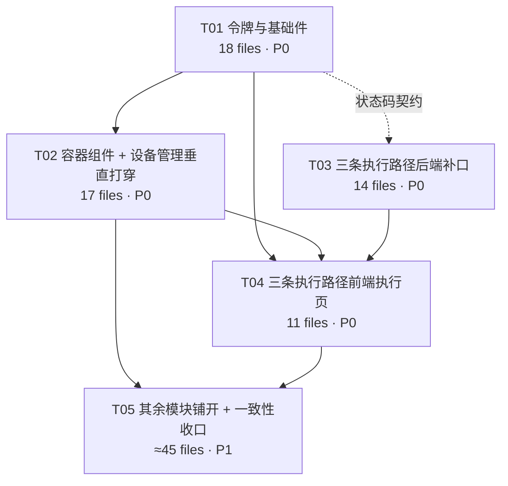

# 知微智造 · 车间交互改造与三条执行路径 — 架构设计与任务分解

| 项 | 内容 |
|---|---|
| 文档定位 | 架构（容器职责 / 令牌体系 / 组件契约 / 三条执行路径的接口与表结构定论 / 任务分解） |
| 上游输入 | `docs/ue-interaction-spec-2026-11-02.md`（UE 方案，440 行十章）+ `docs/ue-evidence/` 8 张双视口截图 |
| 范围决策 | Q3 = 三条执行路径（检验执行 / 出库执行 / 点检执行）**全部纳入**；Q1=Android10+/有物理扫描键/手套模式默认开启；Q2=一期仅离线提示+待提交可见+手动重试；Q4=56 基线；Q5=术语统一「保养」+ 手持隐藏面包屑 |
| 产出日期 | 2026-11-02 |
| 约束 | 本文不含实现代码（可含接口签名 / 类型定义 / DDL 草案）；不重复 UE 已定规则，一律引条目号 |

---

## 0. 本轮代码勘察修正（推翻三项前提，请先看）

UE §0.1 的三项统计在本轮复核中**数值偏低或定位不准**，直接改变任务量估算，先摆出来：

| 项 | UE 文档记载 | 本轮实测 | 影响 |
|---|---|---|---|
| 失效 Tailwind 类名 | 7 处 | **29 处 / 6 个文件**（全部在 `pages/basics/`：CalendarView / OperationList / ProductList / RouteEditor / RouteList / WorkCenterList） | 不是"顺手清 7 处"，是 basics 6 页的布局全部靠失效类撑着 → 清掉后布局会**塌**，必须同步给真样式。纳入 T01 |
| 内联 picker 文件 | 8 个（equipment 2 / wms 3 / quality 3 / production 1） | **8 个**，但分布是 equipment 2 / **wms 2** / quality 3 / production 1：`equipment/MaintenancePlans.vue`、`equipment/MaintenanceTasks.vue`、`production/WorkReportForm.vue`、`quality/InspectionDetail.vue`、`quality/fmea/FmeaActions.vue`、`quality/ppap/PpapSubmissions.vue`、`wms/ReceiptOrderCreate.vue`、`wms/ReceiptOrderDetail.vue` | 数量对，名单须以此为准（wms 第 3 个 `StockMove.vue` 是**独立 popup** 不是内联，属 R1 合格） |
| T2 检验执行"路径不可达" | 路径缺失 | **路径存在但入口不可达**：`pages/quality/InspectionDetail.vue`（304 行）已实现录入 + 批量提交 + 判定 | 见 §3.1，结论从"补功能"降级为"补入口 + 补应检项清单" |

另有一项 UE 未记录、但比 `:hover` 更致命的既有样式：

```
frontend/src/styles/ziwi-variables.css:199
.modal-content { min-width: 480px; max-width: 640px; }
```

412 视口下这句话直接产出 68px 横向溢出（UE-04 必挂）。同类还有 `.modal-content { padding: var(--ziwi-gap-xl) }`、`.ziwi-table th/td { padding: 10px 12px }`（行高 20+12=32 < 48，UE-P0-02/UE-08 必挂）。这些不是"某个页面写错了"，是**令牌层本身就写着桌面假设**，所以 T01 必须先动令牌。

---

# Part A 系统设计

## 1. 实现路径

### 1.1 核心难点判定

| 难点 | 本质 | 对策 |
|---|---|---|
| 塌陷在 21 个模块反复出现（UE §0.2 判断 2） | 缺的是**容器职责**，不是组件用法 | 用 5 个受控组件把 R1–R5 变成**编译期不可违反**的事：业务页不再直接组合 `van-dialog + van-picker` |
| 一份代码出 W/T/H 三态（UE §3.1/§3.2） | 形态不能靠 `@media` 写三遍（会分裂 3 套 DOM） | **同一 DOM + 令牌切换**；形态只决定"容器挂在哪一层"（dialog/drawer/page 是同一个 `van-popup` 的 `position/teleport` 差异），不决定结构 |
| 手持机横竖屏切换要即时重排不刷新（§3.1 规则 3） | 需 JS 感知形态并下发给 DOM | `useFormFactor` 写 `document.documentElement.dataset.formFactor`，CSS 用 `[data-form-factor="H"]` 分支；**不用 UA、不用 resize 节流刷新页面** |
| 手套模式 56 基线且默认开启（Q4） | 同一套样式要两档热区 | 令牌双档 + `[data-glove="on"]` 一条选择器翻转，**组件内不写 if** |
| 333 处内联 style 不再增长 | 没有 ESLint（`package.json` 无 eslint 依赖），只能自建闸 | 新增 `scripts/check_ui_contract.py` 做 ratchet 基线（详见 §8.5） |
| 三条执行路径的过账语义不能改（出库负值/红冲逐腿回滚） | 只能对齐，不能重写 | 出库执行**零改动**复用 `IssueOrderService.issue_item`；只补"入口"和"收口"两条端点（§3.2） |

### 1.2 选型（不引入新框架）

| 决策 | 选择 | 理由 |
|---|---|---|
| 是否引入 Tailwind | **不引入** | 29 处失效类是"装了但没生效"的历史残留。引入等于把 86 个文件重刷一遍，且会与 Vant 的 `--van-*` 主题冲突。改用 `styles/ziwi-utilities.css` 补 6 个原子类（`.ziwi-flex-1` / `.ziwi-w-sheet` / `.ziwi-stack` 等），只服务这 29 处 |
| 是否引入 UI 库 | **不引入**，继续 Vant 4.9 | 已深度耦合（24 dialog / 10 popup / 12 picker / 全局 `app.use(Vant)`） |
| 表单容器形态 | 自建 `ZiwiFormSheet` | Vant 没有"宽度策略内建 + 单一滚动 + 单组按钮"的容器；且必须跨 W/T/H 复用同一份 |
| 选择器形态 | 升级 `SelectField.vue` → `ZiwiSelect`（旧名保留薄壳） | `SelectField` 已是全站唯一正确范式，8 个 basics 页依赖它的全局注册名（`main.ts:17`），改名即炸 8 页 |
| 状态管理 | 不引入新 store；形态/手套/草稿用 composable + 单例 ref | 这些是设备级瞬时状态，进 Pinia 无收益 |
| 架构模式 | 容器/展示分离（Container-Presentational）+ Provide/Inject 承载容器上下文 | R3「内层自带确认时外层不再给」只能通过 `provide/inject` 协商，props 做不到 |
| 后端 | 沿用 FastAPI + SQLAlchemy async + MultiTenantRepository | 见 §3 铁律 |

---

## 2. 组件层契约（最高优先级）

四类上下文由 `ZiwiFormSheet` 通过 `provide` 下发，子组件（`ZiwiSelect` / `ZiwiReceipt` / 自定义）用 `inject` 协商：

```ts
// frontend/src/components/ziwi/context.ts
export const ZIWI_SHEET_CTX: InjectionKey<SheetContext> = Symbol('ziwi:sheet')
export interface SheetContext {
  formFactor: Ref<FormFactor>            // W | T | H
  submitting: Ref<boolean>               // 提交中 → 全表锁定
  requestClose: (reason: CloseReason) => void
  registerOwnedConfirm: (token: symbol) => void   // 声明"本层已有一组确认"
  unregisterOwnedConfirm: (token: symbol) => void
  markDirty: (v: boolean) => void
}
export type CloseReason = 'overlay' | 'gesture' | 'cancel' | 'route-leave' | 'esc'
```

### 2.1 `ZiwiFormSheet` — 表单浮层容器（R1/R2/R3/R4 唯一承载者）

```ts
// props
interface ZiwiFormSheetProps {
  show: boolean                       // v-model:show
  title: string
  variant?: 'auto' | 'dialog' | 'drawer' | 'page'   // 默认 auto
  widthPolicy?: 'ratio' | 'fixed'     // 默认 ratio，见 R2
  dirty?: boolean                     // 有未保存内容 → 禁下滑关闭/遮罩关闭需确认
  submitting?: boolean                // UE-P0-05：提交中锁定
  submitText?: string                 // 默认「确认」
  cancelText?: string                 // 默认「取消」
  hideFooter?: boolean                // 由内层声明 ownedConfirm 时自动置 true
  showFooter?: boolean                // 默认 true
  closeOnOverlay?: boolean            // 默认 false（§6.3 误滑关闭）
  scrollPolicy?: 'sheet-only'         // 唯一合法值，保留字段防被绕开
  formId?: string                     // 配合底部按钮 type=submit
}
// emits
type ZiwiFormSheetEmits = {
  'update:show': [boolean]
  submit: []
  cancel: []
  opened: []
  closed: []
  'close-blocked': [reason: CloseReason]   // 页面向用户解释"为什么关不掉"
}
```

| 项 | 内容 |
|---|---|
| **slots** | `default`（滚动体，**唯一滚动容器**）、`header`（标题右侧，放次级操作，禁放主操作）、`footer-extra`（主操作上方的差异摘要/合计）、`footer`（完全替换按钮区，一旦使用则本组件不再渲染任何按钮） |
| **内部状态** | `effectiveVariant`（`auto` 时由 formFactor 派生：W→dialog / T→drawer / H→page）、`ownedConfirmTokens: Set<symbol>`、`attemptedClose`、`innerScrollTop` |
| **R1** | body 唯一滚动：`overflow-y:auto; overscroll-behavior:contain; touch-action:pan-y`；`provide` 中声明 `scrollPolicy='sheet-only'`。`ZiwiSelect` 收到该声明后**只能**用 `van-popup`（既不进流也不参与本层滚动）。监听 `scroll` 到边界时 `preventDefault` 防滚动链（UE-P0-03 的机械判据） |
| **R2** | 宽度 100% 来自令牌：W = `min(900px, 62vw)`、T = `min(720px, 92vw)`（抽屉右贴边）、H = `100vw`。**写死 `width` 并用 `box-sizing:border-box`**，内容 `min-width:0` + `overflow-wrap:anywhere` → 内层再宽也撑不开外层。禁用 `display:inline-flex` / `width:fit-content` |
| **R3** | 唯一按钮组。`ZiwiSelect`/`ZiwiReceipt`/任何内层组件若自带确认，在 `onMounted` 调 `registerOwnedConfirm(token)`，Sheet 立即 `hideFooter=true`，且底部改为「返回编辑」单按钮；`onUnmounted` 注销（浮层关闭即还原） |
| **R4** | footer 是 **sheet 内部的 `position:sticky; bottom:0`**（不是 `position:fixed`——fixed 会脱离 sheet 的定位上下文，在 T 形态抽屉里会横跨全屏）。H 形态额外 `padding-bottom: env(safe-area-inset-bottom)` |
| **§6.3 误滑关闭** | H 形态 `position=bottom` 时**不设** `close-on-popup-click`；`dirty=true` 时 `requestClose('overlay')` → emit `close-blocked` + 顶部提示「有未保存内容，请先保存或放弃」 |
| **§5.1 校验失败** | 不在此组件内做。由 `ZiwiErrorSummary`（顶部摘要）+ `ZiwiFieldError`（字段就近）承载，Sheet 只提供 `focusFirstError()` 的滚动入口（`emit('scroll-to', selector)`） |
| **三种形态如何一份代码** | 只有三个分支点：① `van-popup position`（center/right/bottom）；② `round` / `safe-area-inset`；③ footer 是否 sticky。DOM 结构、按钮、滚动策略、宽度策略**完全一致** |

### 2.2 `ZiwiSelect` — 枚举选择器（在 `SelectField.vue` 上升级）

```ts
interface ZiwiOption { label: string; value: string | number; code?: string; disabled?: boolean; desc?: string }
interface ZiwiSelectProps {
  modelValue: string | number | null
  options: ZiwiOption[]
  placeholder?: string
  searchable?: boolean | 'auto'      // 默认 'auto'：options.length > 8 强制 true（§3.2）
  searchPlaceholder?: string
  remote?: (keyword: string) => Promise<ZiwiOption[]>   // 服务端搜索（>200 项时必须给）
  clearable?: boolean                // 默认 true
  disabled?: boolean
  size?: 'auto' | 'normal' | 'glove' // auto → 跟随手套模式令牌
  displayMode?: 'label' | 'code'     // code 用于编码类字段
  middleEllipsis?: boolean           // §4.2 长编码中间省略
  scanEntry?: boolean                // 显示扫码按钮位
  emptyKind?: 'true' | 'filtered'    // 复用四类空态文案
  labelWidth?: string
  rules?: unknown[]                  // 透传给 van-field，供 ZiwiFormSheet 定位错误
}
type ZiwiSelectEmits = {
  'update:modelValue': [string | number | null]
  change: [string | number | null, ZiwiOption | null]
  scan: []                           // 交给 useScanInput
  'search-open': []
  invalid: [message: string]
}
```

| 项 | 内容 |
|---|---|
| **slots** | `option`（自定义行：主文案 + 副行编码/描述）、`value`（已选值的自定义展示）、`button`（field 右侧，默认渲染扫码 + 清空） |
| **内部状态** | `show`、`keyword`、`listMode: 'picker' \| 'search-list'`（`searchable=true` → `search-list`；`false` → `picker`）、`activeIndex`（键盘/扫码上下移动）、`remoteLoading` |
| **替换现状的 3 个坑** | ① `selectedValues[0]`（SelectField 已处理，保留）；② 内联进 `#input` 插槽（彻底删除，改 `van-popup position="bottom"`）→ UE-P0-01；③ 100 条滚轮（`>8` 强制 `search-list`，`van-search` + `van-cell` 列表，不是 picker） |
| **清空语义统一** | `clearable` 且非 disabled 时永远渲染清空位（不因"当前无值"而消失）；清空 emit `null`（**不是 `''`**，与 `inspection_order.result` 空值语义一致）；清空后焦点留在 field，不自动弹浮层 |
| **尺寸** | `--ziwi-touch-min` / `--ziwi-touch-glove` 直接量在 `.van-field__body` 与列表行；**不在组件内判断手套模式**（§2.1 令牌双档） |
| **长编码** | `middleEllipsis=true` 时用 `direction:rtl; text-overflow:ellipsis` 的经典中间省略法（保留尾段），点开展开全串 + 一键复制（§4.2） |
| **与 R1 的关系** | 只能渲染 `van-popup`，且 `van-popup` 必须 `teleport="body"`（否则会被 sheet 的 `overflow:hidden` 裁剪 → 表现为"点了没反应"） |
| **旧名兼容** | `components/SelectField.vue` 保留为薄壳：`<ZiwiSelect v-bind="$props" />`，props 集合为旧超集，8 个 basics 页零改动 |

### 2.3 `ZiwiReceipt` — 回执卡（§5.1「保存成功」/ UE-11 / §5.2 三秒可判）

```ts
interface ZiwiReceiptProps {
  show: boolean
  title?: string                      // 默认「保存成功」
  docNo: string                       // 单号，必填 —— UE-11 断言它存在
  docNoLabel?: string                 // 「报工单号」「出库单号」…
  quantities: Array<{ label: string; value: number | string; unit?: string }>  // 关键数量，1–3 项
  time: string                        // 已完成格式化（HH:mm 或 MM-DD HH:mm）
  nextState?: { label: string; semantic: StateSemantic }   // 下一状态（含颜色+文字双编码）
  primaryAction?: { text: string; kind: 'continue' | 'view' }   // 继续新建 / 查看单据
  secondaryAction?: { text: string }
}
type ZiwiReceiptEmits = { 'update:show': [boolean]; primary: []; secondary: []; closed: [] }
```

| 项 | 内容 |
|---|---|
| **slots** | `extra`（差异摘要、被影响对象、NCR 单号）—— 出库执行的"差异摘要"和检验的执行"已转 NCR #12"放这里 |
| **内部状态** | `copied`（复制单号的 2 秒态）、`copyFallback`（http 环境无 `navigator.clipboard` 时显示可选中的文本框） |
| **义务** | 必须由调用方在成功后**显式**打开；禁止用 toast 替代。返回列表后该行高亮 + 滚到可见（§5.1），由页面自身记录 `lastCreatedId` 并在列表 `onMounted` 里 `scrollIntoView` 承担（不抽公共件，各页一行） |
| **禁止** | 不带 `docNo` 就渲染（UE-11 是 P1 红线判据）—— `docNo` 为空时组件 `console.error` 并且不渲染 |

### 2.4 `ZiwiStateView` — 五态统一视图（§5.1 七状态中的五类载体）

```ts
type StateKind =
  | 'loading'         // 骨架，保持最终布局尺寸
  | 'empty-true'      // ①真无数据：说明 + 主操作「新建第一个…」
  | 'empty-filtered'  // ②筛选无结果：回显条件标签 + 「清空条件」
  | 'empty-scoped'    // ③无权限/无数据范围：「当前仅显示本班组数据」+ 联系管理员
  | 'failed'          // ④加载失败：「加载失败」+ 重试（区分网络/业务，§5.1 离线）
  | 'forbidden'       // 403：所需权限码可复制（§5.1 无权限）
  | 'offline'         // 离线 + N 条待提交
  | 'ready'           // 透传 default 插槽

interface ZiwiStateViewProps {
  state: StateKind
  skeleton?: 'rows' | 'cards' | 'detail'
  skeletonCount?: number              // 列表首屏 3 行（§5.1）
  permCode?: string                   // forbidden 必填
  conditions?: string[]               // empty-filtered 回显
  pendingCount?: number               // offline
  error?: { kind: 'network' | 'business'; message?: string }
  primaryText?: string                // 空态动作文案
  minHeight?: string                  // 保持布局不跳动
}
type ZiwiStateViewEmits = {
  retry: []; 'clear-filter': []; create: []; 'copy-perm': []; back: []; 'view-queue': []
}
```

| 项 | 内容 |
|---|---|
| **slots** | `default`（`ready` 时）、`skeleton`（自定义骨架）、`action`（覆盖默认动作） |
| **分工** | 本组件只承载五类。**校验失败**由 `ZiwiErrorSummary + ZiwiFieldError`；**保存成功**由 `ZiwiReceipt`；**危险操作**由 `ZiwiConfirmSheet`。UE-09 的七状态可枚举性由「这四者 + 本组件」合并覆盖 |
| **禁止** | 任何页面直写 `van-empty description="暂无数据"`；`failed` 与 `offline` 必须文案与动作不同（UE-12） |

### 2.5 `useFormFactor` — 形态判定（§3.1）

```ts
type FormFactor = 'W' | 'T' | 'H'
interface FormFactorState {
  formFactor: FormFactor
  width: number
  orientation: 'portrait' | 'landscape'
  canHover: boolean          // matchMedia('(hover: hover) and (pointer: fine)')
  isCoarse: boolean          // matchMedia('(pointer: coarse)')
  touchTarget: number        // 48 | 56（手套模式）
}
export function useFormFactor(): Readonly<Ref<FormFactorState>>
export function installFormFactor(app: App): void   // main.ts 调一次，写 <html data-form-factor>
```

判定实现（**唯一真源** `config/formFactor.ts`，与 CSS `@media` 字面量由静态闸对齐）：

```
H: width < 600  ||  (orientation === 'portrait' && width < 768)
T: (600 <= width < 1024)  ||  (width >= 1024 && !canHover)
W: width >= 1024 && orientation === 'landscape' && canHover
```

| 要求（UE §3.1） | 实现 |
|---|---|
| 不做设备嗅探 | 只读 `innerWidth` / `visualViewport` / `matchMedia`，**不读 UA** |
| 手持机横竖屏切换即时重排不刷新 | 监听 `window.onresize` + `matchMedia('(orientation: portrait)').change`，**只改 `dataset.formFactor` 与一组 CSS 变量**，不 `location.reload`、不重建组件树。要求：所有形态相关样式必须写在 `[data-form-factor="H"]` 选择器下，而非 JS 条件渲染 |
| 宽度为主判据 | `width` 是唯一主输入；`canHover` 只作增强降级（W 形态在纯触屏 1024 上降为 T） |
| 纯触屏不得丢信息（UE-06） | `canHover=false` 时 `<html data-hover="off">`，CSS 中所有 `:hover` 规则必须写在 `[data-hover="on"]` 下 —— 这样"只有悬停才可见"的东西在触屏机型上会**直接可见**而非不可见 |
| 单例 | `inject` 优先（App 层 provide），无 provider 时回退模块级单例，保证 86 页共享一个监听器 |

### 2.6 组件与 UE 条目追溯矩阵

| 组件 | 承载条目 |
|---|---|
| `ZiwiFormSheet` | R1 R2 R3 R4；§3.2 表单/详情/危险确认三行；§6.3 误滑关闭；UE-P0-03/04、UE-02/03/05 |
| `ZiwiSelect` | R1 §3.3；§3.2 枚举选择器行；§4.2 长编码；§6.1 尺寸；§2.5 扫码优先；UE-P0-01/02、UE-08/15/22 |
| `ZiwiReceipt` | §5.1 保存成功；§5.2；§5.3 载体表；UE-11 |
| `ZiwiStateView` | §5.1 加载/空四类/失败/无权限/离线；§5.3；UE-09/12/14 |
| `useFormFactor` | §3.1 全部；UE-06 |
| `ZiwiActionBar`（T01） | R4；§8 操作按钮位置；UE-03 |
| `ZiwiConfirmSheet`（T02） | §5.1 危险操作两档；§6.2 长按；UE-13 |
| `ZiwiErrorSummary` + `ZiwiFieldError`（T02） | §5.1 校验失败四条；UE-10 |
| `ZiwiOfflineBar` + `useOfflineQueue`（T05） | §5.1 离线；Q2 一期口径；UE-12 |
| `useDirtyGuard`（T01） | §8 返回行为；UE-16 |
| `useSubmitLock`（T01） | §6.3 重复提交；UE-P0-05 |

---

## 3. 三条执行路径：缺口分析与定论

> 本节每条结论都基于对 `backend/app/api/*.py`、`backend/app/services/*.py`、`backend/app/models/*.py` 的实际阅读，不含推测。

### 3.1 检验执行 → **结论：可复用现有接口**

**现有能力（全部已实现，无需改一条写语义）**

| 用途 | 方法 + 路径 | 位置 |
|---|---|---|
| 扫码定位待检单（含"能不能录"结论） | `GET /api/v1/inspection-orders/scan?code=` | `quality.py:280` |
| 待录入清单（带 `recorded_count`） | `GET /api/v1/inspection-orders/pending-entry?limit=&mine=` | `quality.py:306` |
| 单头 + 已录明细 | `GET /inspection-orders/{id}`、`GET /inspection-orders/{id}/results` | `quality.py:324/714` |
| 批量录入（自动按上下限判 PASS/FAIL、同单同项幂等更新、已判定单拒录） | `POST /inspection-orders/{id}/results/batch` | `quality.py:723` |
| Ac/Re 建议判定（不落库，给人裁量权） | `GET /inspection-orders/{id}/verdict` | `quality.py:373` |
| 判定（REJ → 自动回写 `receipt_order_items.inspection_status='disqualified'` + 冻结批次 + 开 NCR） | `PUT /inspection-orders/{id}/judge` | `quality.py:505` |
| 设备直推（预留通道，与人工同一条写路径） | `POST /inspection-results/device-push` | `quality.py:762` |

涉及表：`inspection_order`、`inspection_result`、`inspection_item`、`inspection_standard`、`qc_point_config`、`receipt_order_items`、`batches`。

**缺什么（只有一处，且是只读）**

`inspection_order` 表**没有 `standard_id`**（见 `models/quality.py:66-95`），`inspection_item` 只挂 `standard_id`，`qc_point_config` 只挂 `material_id/process_id` —— 三者之间**没有任何 JOIN 路径**能从一张检验单走到"本单应检项"。现状前端 `InspectionDetail.vue:93` 的做法是：

```ts
get('/inspection-items', { page: 1, page_size: 100 })   // 拉全站前 100 个检验项
```

后果：① 超过 100 个检验项的租户**静默截断**，检验员看不到该测的项；② 检验员在一堆无关项里挑，正是 UE §2.2 说的"逐项录入反复滚动"。这是**静默失效**，必须治。

**需新增（1 列 + 1 只读端点）**

```sql
ALTER TABLE inspection_order ADD COLUMN standard_id BIGINT NULL;
-- 加列依据：检验单必须知道自己按哪份标准检；不加则"应检项"永远只能靠猜。
-- NULL 合法（历史单 + 口头检验），此时 checklist 端点显式返回 degraded=true。
```

```
GET /api/v1/inspection-orders/{order_id}/checklist
响应:
{
  "code": 0, "message": "success",
  "data": {
    "order_id": 12,
    "standard_id": 3, "standard_name": "来料检验标准 v1.0",
    "degraded": false,            // true = 本单未挂标准，返回全部启用检验项
    "recorded_count": 4,          // 已录项数
    "items": [
      { "id": 31, "item_name": "外径", "spec_lower_limit": 39.95, "spec_upper_limit": 40.05,
        "unit": "mm", "method": "卡尺", "sort_order": 1,
        "recorded": true, "measured_value": 40.01, "result": "PASS" }
    ]
  }
}
```

- 权限码：GET → `M03:inspection_order:read`（自动推导，无需登记后缀）
- 实现要点：**一条 `LEFT JOIN inspection_result ON order_id AND item_id` 取"应检项 + 已录值"**，禁止"先查项再逐项查结果"（N+1）。若放进列表端点则必须 `LEFT JOIN + COUNT(DISTINCT)`，禁相关子查询（铁律 2）
- 前端新增 `pages/quality/InspectionExecute.vue`（扫码直达 + 逐项卡片 + 底部固定提交），`InspectionDetail.vue` 退化为只读详情 + 「开始执行」入口 → 解决"入口不可达"，不动任何写逻辑

**为什么不是"需新增接口"**：三条执行路径里只有这一条**写入闭环已 100% 存在**（含幂等、自动判定、抽样闸门、NCR 联动）。新增的是一条只读清单端点 + 一个空列，不新增状态机、不改过账。

### 3.2 出库执行 → **结论：需新增接口**

**现有能力（过账语义完整，一字不改）**

`POST /api/v1/wms/issue-order-items/{item_id}/issue`（`wms.py:750` → `IssueOrderService.issue_item`，`wms_service.py:958-1130`）已经实现：

| 语义 | 实现事实（`wms_service.py`） |
|---|---|
| `receive` = receipt 待检区入账 / `store` = transfer 库内移库 | 属入库侧（`receipt-order-items/{id}/receive`、`/store`），出库不涉及 |
| `issue` 数量记**负值** | `_create_issue_tx(..., -take, ...)`（L1028、L1071、L1104），`transaction_type='issue'` |
| 红冲按 `from_location_id + batch_no` 逐腿回滚 | `cancel_issue_order`（方案 B 状态感知）：pending/approved/picking → 仅置 `cancelled` 零库存影响；issued/partially_issued → 回滚库存 + 写冲销流水 |
| 行级部分出库可区分 | `pick_status = 'picked' if new_issued >= required else 'partial'`（L1119） |
| 数量累计不覆盖 | `new_issued = (item.issued_qty or 0) + qty`（L1118） |
| 单据级状态自动流转 | `issued if total_issued >= total_required else partially_issued`（L1132） |
| 批次 FIFO/LIFO/manual + 过期拦截 | `find_available_batches` + `_reject_expired_batch`（L1135） |
| 批次回写单据行（跨批次不写，避免误导） | `if len(distinct) == 1: patch['batch_no'] = ...`（L1127） |

涉及表：`issue_orders`、`issue_order_items`、`inventory`、`inventory_transactions`、`batches`、`materials`。

**缺什么（三处，其中两处是接口级）**

1. **无扫码入口**。全库无 `/issue-orders/scan`。现场扫的是出库单号 / 工单号 / 物料码，三种码解析规则不同，让前端自己拼 `?keyword=` 拼出来的结果是"扫了没反应"或"命中一堆"。这正是 `quality.py:280` 那段注释已经踩过的坑（C-79）。
2. **无短发结案**。行欠发 8 个 → 单据永远停在 `partially_issued`。`total_issued >= total_required` 是唯一出口，没有"就发这么多、差额结案"的动作 → 僵尸单永久堆积，列表上永远排在最前面。
3. **前端无详情/执行路由**。`IssueOrderList.vue:86` 的 `<van-cell :to="'/wms/issue-orders/${item.id}'">` 指向一个**不存在的路由**（`router/index.ts` 里只有 `wms/issue-orders` 列表），点了直接落 404 兜底页。这是 UE §2.3「列表行展开（只读明细）→ 无执行入口」的真实成因。

**需新增（2 条端点 + 0 张表变更）**

```
① GET /api/v1/wms/issue-orders/scan?code={扫码内容}
   ★ 必须注册在 /issue-orders/{io_id} 之前（路由遮蔽第五次复发风险；io_id 为 int，
     见 quality.py:256 与 tpm.py:104 的同型注释）
   权限码: M04:wms_issue_order:read（GET 恒 read，'scan' 不必登记后缀）
   响应:
   { "code":0, "data": {
       "order": { id, issue_no, status, warehouse_id, warehouse_name, department_id,
                  recipient, source_doc_no, total_qty, issued_qty },
       "matched_by": "issue_no" | "work_order_no",     // 扫到的是什么
       "can_execute": true,                            // status ∉ {issued, cancelled}
       "blocked_reason": null,                         // 例："出库单已取消"
       "lines": [ { item_id, line_no, material_id, material_code, material_name,
                    required_qty, issued_qty, remain_qty, unit,
                    batch_no, from_location_id, pick_status,
                    suggest_batch_no, suggest_location_name   // FIFO 建议，供"实发默认=需求"直接过账
                  } ],
       "summary": { "line_count": 6, "done_lines": 2, "diff_lines": 1 }
   }}
   解析顺序: issue_orders.issue_no → work_orders.wo_no（反查 issue_orders.work_order_id）
   两侧都未命中 → 404 {"code":"404-0000","message":"未找到出库单：<code>"}

② POST /api/v1/wms/issue-orders/{io_id}/complete
   权限码: M04:wms_issue_order:execute（'complete' 已在 EXECUTE_SUFFIXES 登记）
   请求体: { "allow_shortage": bool, "reason": string|null, "remark": string|null }
   语义:
     - 全部行 pick_status='picked' → 置 issued, completed_at=now, issued_by=当前用户
     - 存在欠发行 且 allow_shortage=false → 400
       {"code":"WMS_400_SHORTAGE","message":"第 3 行尚欠 8 PCS，请继续拣货或勾选差额结案"}
     - 存在欠发行 且 allow_shortage=true  → 置 issued(short_closed), 写 audit(WMS_SHORT_CLOSE)
   响应: { order_id, status, issued_qty, required_qty, shortage_lines:[{line_no,material_code,short_qty,unit}] }
   状态机迁移: partially_issued --complete(allow_shortage=true)--> issued
              (新增字段 issue_orders.short_closed BOOLEAN NOT NULL DEFAULT false,
               shortage_reason TEXT NULL —— 两列，PG 严格：boolean 写 false 不写 0)
```

**为什么是"需新增接口"**：过账本身不缺，缺的是"进门"（scan）与"出门"（complete）。没有 complete，`partially_issued` 是一个**无出口状态**——这在状态机上是硬缺陷，不是交互问题。

### 3.3 点检执行 → **结论：需新增接口（含 1 张新表 + 1 列）**

**现有能力**

| 用途 | 方法 + 路径 | 说明 |
|---|---|---|
| 保养任务 CRUD | `GET/POST/PUT/DELETE /api/v1/maintenance-tasks` | `tpm.py:93-137` |
| 逾期清单 | `GET /maintenance-tasks/overdue` | `tpm.py:105`（F-E1 升级等级） |
| 到期计划生成任务（同日同计划幂等） | `POST /maintenance-tasks/generate-due` | `tpm.py:184` |
| 开工（设备转 `maintenance` + 开停机记录 + 受影响工单暂停） | `PUT /maintenance-tasks/{id}/start` | `tpm.py:201` → `MaintenanceService.start_task` |
| 完工（关停机算时长 + 设备 `running` + 工单恢复顺延 + 计划滚下一周期） | `PUT /maintenance-tasks/{id}/complete` | `tpm.py:216` → `MaintenanceService.complete_task` |
| 设备查询（可按 `keyword`） | `GET /api/v1/equipment?keyword=` | `tpm.py:26` |

涉及表：`maintenance_tasks`、`maintenance_plans`、`equipment`、`equipment_downtimes`、`spare_part_inventories`。

**缺什么（致命：项级载体完全不存在）**

`maintenance_tasks` 只有 `result = Column(Text)`（`models/tpm.py:77`）——**一个自由文本**。全库 grep `checklist / check_item / maintenance_task_item` 零命中（只有 QC 侧的 `inspection_item`，是品质模块的，语义与 TPM 点检不同）。

由此连带缺失：
- 无"项级三态"（正常 / 异常 / 不适用）→ UE §2.4 目标态无从落地
- 无"几项异常"→ 无法把异常项自动挂安灯/报修（UE §2.4 完成标志要求的"已生成安灯/报修"）
- 无逐项拍照/描述 → 设备员"报修/停机上报"的场景缺载体
- `task_type` 是自由文本（`String(50)`），`priority` 是裸 Integer（0/1/2/3 无枚举）→ UE §2.4 明确列为反例

**需新增 DDL 草案**

```sql
-- 1) 任务项（执行载体，必需）
CREATE TABLE maintenance_task_items (
  id            BIGSERIAL PRIMARY KEY,
  tenant_id     VARCHAR(50) NOT NULL,              -- ★ 应用层显式写（基类只注入 UPDATE/DELETE）
  task_id       BIGINT      NOT NULL,
  line_no       INTEGER     NOT NULL,
  check_item    VARCHAR(200) NOT NULL,             -- 点检项目名
  check_method  VARCHAR(200) NULL,                 -- 点检方法（目视/手感/卡尺）
  standard_desc VARCHAR(200) NULL,                 -- 判定基准描述
  sort_order    INTEGER     NOT NULL DEFAULT 0,
  verdict       VARCHAR(16) NULL,                  -- normal / abnormal / na（NULL = 未点检）
  measured_value NUMERIC(18,6) NULL,
  remark        VARCHAR(500) NULL,
  photo_urls    JSON        NULL,                  -- 异常拍照，最多 3 张
  checked_by    BIGINT      NULL,
  checked_at    TIMESTAMPTZ NULL,
  created_at    TIMESTAMPTZ NOT NULL DEFAULT now(),
  UNIQUE (tenant_id, task_id, line_no)
);
CREATE INDEX ix_mti_task ON maintenance_task_items (tenant_id, task_id);

-- 2) 计划上的点检项模板（配置态，用 JSON 一列，不建表）
ALTER TABLE maintenance_plans ADD COLUMN checklist_template JSON NULL;
-- 取舍：模板不需要被统计查询，只被 generate-due 快照进 task_items。
-- 建独立模板表要再加 CRUD + 权限码 + 页面，收益仅"可 SQL 查模板"，一期不值。

-- 3) 任务类型/优先级枚举化（对齐 UE §2.4「全部枚举化」）
--    task_type 已存在（repair/maintenance/inspection），补 CHECK 约束；
--    priority 保留 Integer 但限定 0/1/2（低/中/高），前端只暴露三档语义。
```

**需新增端点（3 条）**

```
① GET /api/v1/tpm/equipment/scan?code={设备码}
   ★ 必须注册在 /equipment/{eq_id} 之前
   权限码: M06:equipment:read
   响应: { equipment: {id, equipment_code, equipment_name, status, location},
           tasks: [ {task_id, task_no, task_type, status, scheduled_start_at,
                     item_count, checked_count, abnormal_count, overdue_level} ],
           empty_kind: "no_task" | null }     // 0 条 → 前端给空态 + 「新建计划」
   实现: equipment.equipment_code 精确匹配（先 code 后 name，避免模糊命中多台）

② GET /api/v1/tpm/maintenance-tasks/{task_id}/checklist
   权限码: M06:maintenance_task:read
   响应: { task_id, task_no, equipment_id, equipment_name, status,
           template_source: "plan" | "manual" | "none",
           items: [ {id, line_no, check_item, check_method, standard_desc,
                     verdict, measured_value, remark, photo_urls, checked_at} ] }

③ POST /api/v1/tpm/maintenance-tasks/{task_id}/checklist
   权限码: M06:maintenance_task:execute
   ★ 必须把 "checklist" 登记进 constants/modules.py 的 EXECUTE_SUFFIXES。
     不登记 → 资源名被推成 maintenance_task_checklist → 权限码
     M06:maintenance_task_checklist:create 无人拥有 → 除通配 * 全员 403，
     且报错文案指向页面上不存在的权限项（C-44/C-45/A-S1/C-65 同型，已是第五次）
   请求体:
   {
     "items": [ { "item_id": 31, "verdict": "abnormal", "measured_value": 0.12,
                  "remark": "皮带打滑", "photo_urls": ["/static/..."] } ],
     "conclude": false,                  // true = 提交并同时完工
     "abnormal_action": "andon" | "repair" | "none"   // 异常项联动
   }
   语义:
     - 逐项写入 maintenance_task_items（同 task 同 item 幂等更新，复点检）
     - task.status='completed' 时拒写（终态，同 inspection 的判定即终态的取舍）
     - conclude=true → 内部调 MaintenanceService.complete_task(payload 含 abnormal_count)
     - abnormal_action 与异常项同时存在时，调用 andon 创建 call_type='equipment'
       （复用 POST /api/v1/andon/calls，不新写停机逻辑 —— equipment_downtimes 由安灯自动开）
   响应: { task_id, checked_count, abnormal_count, status,
           andon_call_id?: 0, blocked?: {item_id, reason} }
```

**为什么是"需新增接口"**：写入侧需要一张**新的明细表**，这是"缺数据载体"而非"缺交互"。现有 `maintenance_tasks` 的 start/complete 联动逻辑（设备状态、停机时长、工单顺延、计划滚动）**一行不改**，新端点只在其前面加一层"逐项打勾"。

### 3.4 三条路径一览（给工程师的一句话结论）

| 路径 | 结论 | 后端工作 | 前端工作 |
|---|---|---|---|
| 检验执行 | **可复用现有接口** | 1 列 + 1 只读端点 | 新增执行页 + 详情页收敛 + 扫码入口 |
| 出库执行 | **需新增接口** | 2 端点 + 2 列（`short_closed`、`shortage_reason`） | 新增详情页 + 执行页（**修 404**）+ 扫描连续扫码 |
| 点检执行 | **需新增接口** | 1 新表 + 1 JSON 列 + 3 端点 + 枚举约束 | 新增设备任务页 + 执行页（项级三态） |

---

## 4. 令牌体系扩展方案

### 4.1 分层与命名

新增 3 个 CSS 文件，**不改 `ziwi-variables.css` 既有变量名**（避免 86 页回归）：

| 文件 | 职责 |
|---|---|
| `styles/ziwi-variables.css`（改造） | 补 `--ziwi-gap-2xs/3xl`、行高三档、`.modal-content` 的 `min-width:480px` 删除；既有名一个不改 |
| `styles/ziwi-tokens.css`（新增） | 触屏尺寸 / 断点镜像 / 状态语义色双编码 / 行高 / 层级 z-index |
| `styles/ziwi-tokens.gloves.css`（新增） | `[data-glove="on"]` 下的全套手套档覆盖（**唯一**手套相关文件） |
| `styles/ziwi-motion.css`（新增） | 动效四档 token 槽位 + `prefers-reduced-motion` 降级 |
| `styles/ziwi-utilities.css`（新增） | 6 个原子类，替换 29 处失效 Tailwind |

### 4.2 断点阈值

CSS 变量**不能**用于 `@media`，所以断点必须有 JS/TS 真源：

| 名 | 值 | 用途 |
|---|---|---|
| `--ziwi-bp-handheld` | `600px` | H 上界（宽） |
| `--ziwi-bp-portrait-max` | `768px` | 竖屏 H 上界 |
| `--ziwi-bp-medium` | `1024px` | T/W 分界 |

- 真源：`config/formFactor.ts` 导出 `BREAKPOINTS = { HANDHELD: 600, PORTRAIT_MAX: 768, MEDIUM: 1024 }`
- 镜像：`ziwi-tokens.css` 里同名变量（仅作文档与调试，`getComputedStyle` 可读）
- **静态闸**（§8.5）断言：所有 `.vue`/`.css` 里的 `@media (min-width: Npx)` / `(max-width: Npx)` 的 N 必须 ∈ {600, 768, 1024}，否则 fail。当前全站 6 处 `@media` 需逐一核对

### 4.3 触屏尺寸（48 / 56 双档）

```css
:root {
  --ziwi-touch-min:        48px;   /* 最小可点热区（UE-P0-02 阈值） */
  --ziwi-touch-danger:     56px;   /* 危险操作热区 */
  --ziwi-touch-gap-adj:     8px;   /* 同组相邻可点元素间距 */
  --ziwi-touch-gap-sem:    24px;   /* 不同语义可点元素间距（§6.3 误触删除） */
  --ziwi-row-min-h:        48px;   /* 列表行最小高（推荐值见推荐 token） */
  --ziwi-row-recommended:  52px;
  --ziwi-input-h:          48px;   /* 输入框可点高度 */
  --ziwi-actionbar-h:      56px;   /* 底部主操作条 */
  --ziwi-close-hit:        48px;   /* 浮层关闭按钮热区 */
}
[data-glove="on"] {
  --ziwi-touch-min:        56px;
  --ziwi-touch-danger:     64px;
  --ziwi-touch-gap-adj:    12px;
  --ziwi-row-min-h:        56px;
  --ziwi-row-recommended:  64px;
  --ziwi-input-h:          56px;
  --ziwi-actionbar-h:      64px;   /* 含 safe-area 留白 */
  --ziwi-close-hit:        56px;
  /* --ziwi-touch-gap-sem 保持 24：手套不改变"不同语义要分开"的语义要求 */
}
```

取值依据 UE §6.1 表格逐行对应；`--ziwi-touch-gap-sem` 在手套档**不放大**，理由是 §6.1 原文即为 24/24，且 24 已是防误触下限。

### 4.4 行高与间距刻度

```css
:root {
  --ziwi-lineheight-tight:  1.25;   /* 单行数据/表格单元格 */
  --ziwi-lineheight-normal: 1.5;    /* 正文/字段值 */
  --ziwi-lineheight-loose:  1.7;    /* 多行备注/异常描述 */
}
```

间距刻度沿用既有 `--ziwi-gap-*`（4-based），**只补两端**：`--ziwi-gap-2xs: 2px`、`--ziwi-gap-3xl: 48px`。
约定：新代码禁止裸 `px` 写 margin/padding；必须在 `--ziwi-gap-*` 里选。允许裸 px 的例外仅三类：`1px` 边框、`0`、`env(safe-area-inset-*)`。

### 4.5 状态语义色 · 双编码

UE §1.2「状态不能只用颜色」、§3.2「状态语义与其文字表述必须一致」。因此拆成**两半**：

```css
/* 一半在 CSS：颜色。每个语义档 4 个变量（fg/bg/border/icon） */
:root {
  --ziwi-state-neutral-fg:#475569; --ziwi-state-neutral-bg:#f1f5f9; --ziwi-state-neutral-bd:#e2e8f0;
  --ziwi-state-progress-fg:#0369a1; --ziwi-state-progress-bg:#e0f2fe; --ziwi-state-progress-bd:#bae6fd;
  --ziwi-state-success-fg:#15803d;  --ziwi-state-success-bg:#dcfce7;  --ziwi-state-success-bd:#bbf7d0;
  --ziwi-state-warning-fg:#92400e;  --ziwi-state-warning-bg:#fef3c7;  --ziwi-state-warning-bd:#fde68a;
  --ziwi-state-danger-fg:#991b1b;   --ziwi-state-danger-bg:#fee2e2;   --ziwi-state-danger-bd:#fecaca;
}
```

```ts
// 另一半在 TS：文字 + 图标。缺任一半即为违规（静态闸检查 tag 是否同时有 text 与 icon）
// frontend/src/config/statusDict.ts
export type StateSemantic = 'neutral' | 'progress' | 'success' | 'warning' | 'danger'
export interface StateEntry { label: string; semantic: StateSemantic; icon: string; order: number }
export const STATUS_DICT: Record<string, Record<string, StateEntry>> = {
  wms_issue:      { pending: {...}, picking: {...}, partially_issued: {...}, issued: {...}, cancelled: {...} },
  wms_receipt:    { ... },
  maintenance_task:{ pending: {...}, in_progress: {...}, completed: {...}, canceled: {...} },
  maintenance_item:{ normal: {...}, abnormal: {...}, na: {...} },
  inspection_order:{ '': {...}, ACC: {...}, REJ: {...}, UAI: {...} },
  inspection_result:{ PASS: {...}, FAIL: {...} },
  equipment:      { running: {...}, idle: {...}, maintenance: {...}, fault: {...}, scrapped: {...} },
  // …逐模块追加，一次加完并用 scripts/check_ui_contract.py 断言"页面内不得出现内联 statusLabel"
}
```

覆盖范围：现有 24 个页面里各写一份 `statusLabel`/`statusColor`/`RESULT_MAP`（grep 命中 24 文件），全部改为 `useStatusTag('wms_issue', status)`。

### 4.6 动效四档（只给档位名与用途）

```css
/* styles/ziwi-motion.css
   ★ 本文件只声明"槽位"，具体时长/缓动/位移由 UI 阶段填。
   组件只允许引用 var(--ziwi-motion-），禁止写裸 transition 时长。 */
:root {
  --ziwi-motion-tap-duration:     ; /* 瞬时档 */
  --ziwi-motion-tap-easing:       ;
  --ziwi-motion-result-duration:  ; /* 快速档 */
  --ziwi-motion-result-easing:    ;
  --ziwi-motion-layer-duration:   ; /* 常规档 */
  --ziwi-motion-layer-easing:     ;
  --ziwi-motion-layer-distance:   ;
  --ziwi-motion-wait-duration:    ; /* 舒缓档（循环） */
  --ziwi-motion-wait-easing:      ;
}
```

| 档位 | 令牌前缀 | 承载 UE §7.2 的信息功能 | 用途 |
|---|---|---|---|
| **瞬时** | `--ziwi-motion-tap-*` | **A1 按下已注册** | 任何可点元素按下态（含禁用态的"按了但无效"区分）。触屏无悬停，这是唯一的手感来源 |
| **快速** | `--ziwi-motion-result-*` | **A2 操作已生效** + **A6 注意力引导** | 提交成功、状态标签变更、数量累加、校验失败定位、新建行高亮 |
| **常规** | `--ziwi-motion-layer-*` | **A3 层级关系** + **A4 方向与进度** + **A7 临界预告** + **A8 空间连续性** | 浮层/抽屉/全屏页进出、分步表单前进后退、长按进度环、列表↔详情返回 |
| **舒缓** | `--ziwi-motion-wait-*` | **A5 等待中时长感知** | 超过即时响应预期的请求、扫码识别中、批量提交 |

降级（§7.3）：

```css
@media (prefers-reduced-motion: reduce) {
  /* 保留 A1/A2/A6（必需反馈）：只留"无位移"的透明度切换 */
  :root { --ziwi-motion-layer-distance: 0px; }
  /* A5 仅保留静态进度指示 */
  .ziwi-wait-anim { animation: none; }
}
```

纪律落点：`styles/ziwi-motion.css` 顶部注释写死「同一信息功能在 21 模块必须同一档位」，静态闸断言 `.vue` 内不出现 `transition:.*\d+m?s`（裸时长）与 `cubic-bezier`（当前 0 处，保持 0）。

### 4.7 Vant 变量桥接（单向：`--van-*` ← `--ziwi-*`）

`styles/vant-overrides.css` 从 10 行扩到约 40 行，原则：**只许 `--van-X: var(--ziwi-Y)`，不许反向**。

| Vant 变量 | 桥接自 | 为什么必须 |
|---|---|---|
| `--van-cell-font-size` | `--ziwi-font-size-lg`(14) | 现场 30–80cm，13px 认不出 |
| `--van-cell-vertical-padding` | `--ziwi-gap-md`(12) → 手套档 `--ziwi-gap-lg` | 决定行高 ≥48/56（UE-08） |
| `--van-cell-line-height` | `--ziwi-lineheight-normal` | 同上 |
| `--van-cell-right-icon-color` | `--ziwi-text-muted` | 触屏箭头要更粗（配合 `--ziwi-touch-min`） |
| `--van-field-input-text-color` | `--ziwi-text-primary` | — |
| `--van-button-default-height` | `--ziwi-touch-min` | 按钮热区（UE-P0-02） |
| `--van-button-default-font-size` | `--ziwi-font-size-lg` | 同上 |
| `--van-picker-toolbar-height` | `--ziwi-actionbar-h` | 选择器工具栏必须拇指可达 |
| `--van-picker-option-height` | `--ziwi-touch-min` | 滚轮行高 |
| `--van-popup-round-radius` | `--ziwi-radius-xl` | — |
| `--van-overlay-background` | `rgba(0,0,0,.45)` | 高光环境下 0.4 偏浅 |
| `--van-dialog-border-radius` | `--ziwi-radius-lg` | — |
| `--van-nav-bar-height` | `--ziwi-actionbar-h` | 触屏顶栏高度 |
| `--van-tag-padding` | `0 var(--ziwi-gap-sm)` | — |
| `--van-empty-description-color` | `--ziwi-text-secondary` | — |

手套档在 `[data-glove="on"]` 下重写其中 4 个（`cell-vertical-padding`、`button-default-height`、`picker-option-height`、`nav-bar-height`）。

**风险提示**：这一段一旦合入，Vant 组件在全站 86 页的高度/字号同时变化。见 §10 风险 R2。

---

## 5. 文件清单

### 5.1 新增 — 令牌与基础件（T01）

| 路径 | 用途 |
|---|---|
| `frontend/src/styles/ziwi-tokens.css` | 断点镜像 / 触屏尺寸 / 间距补位 / 状态语义色 / 行高 / z-index 层级 |
| `frontend/src/styles/ziwi-tokens.gloves.css` | `[data-glove="on"]` 全套手套档覆盖（唯一手套文件） |
| `frontend/src/styles/ziwi-motion.css` | 动效四档槽位 + 减少动效降级 |
| `frontend/src/styles/ziwi-utilities.css` | 6 个原子类，替换 29 处失效 Tailwind |
| `frontend/src/config/formFactor.ts` | `BREAKPOINTS` + `resolveFormFactor()` —— 形态判定唯一真源 |
| `frontend/src/config/statusDict.ts` | `STATUS_DICT` + `StateSemantic` —— 状态字典唯一真源 |
| `frontend/src/config/uiText.ts` | 文案模板函数（校验/四类空态/错误/回执/危险/离线） |
| `frontend/src/config/term.ts` | 术语表（Q5：维护→保养；报工管理→报工；设备/机台→设备） |
| `frontend/src/composables/useFormFactor.ts` | 形态判定 + `<html data-form-factor>` 下发 + 单例 |
| `frontend/src/composables/useGloveMode.ts` | 手套模式（localStorage `ziwi:glove-mode`，角色默认开启） |
| `frontend/src/composables/useStatusTag.ts` | `useStatusTag(domain, code)` → `{label, semantic, icon, cssVars}` |
| `frontend/src/composables/useDirtyGuard.ts` | 草稿保留（sessionStorage）+ 关闭确认 + 路由离开拦截（UE-16、§8） |
| `frontend/src/composables/useSubmitLock.ts` | 幂等提交锁：`run(fn)` 同键并发只发一次（UE-P0-05） |
| `frontend/src/composables/useScanInput.ts` | 扫码聚合：物理扫描键（连续字符 + Enter 阈值）+ 软扫 + 防抖 |
| `frontend/src/components/ziwi/ZiwiActionBar.vue` | 底部主操作条（R4、UE-03），Sheet 与执行页共用 |
| `frontend/src/components/ziwi/context.ts` | `ZIWI_SHEET_CTX` / 类型定义 |
| `scripts/check_ui_contract.py` | UI 契约静态闸（见 §8.5） |
| `scripts/ui_contract_baseline.json` | 闸的 ratchet 基线快照 |

### 5.2 新增 — 容器组件（T02）

| 路径 | 用途 |
|---|---|
| `frontend/src/components/ziwi/ZiwiFormSheet.vue` | 表单浮层容器（R1/R2/R3/R4） |
| `frontend/src/components/ziwi/ZiwiSelect.vue` | 枚举选择器（升级 SelectField） |
| `frontend/src/components/ziwi/ZiwiSelectList.vue` | 搜索型选项列表（>8 项时替代 picker 的内部件） |
| `frontend/src/components/ziwi/ZiwiReceipt.vue` | 回执卡 |
| `frontend/src/components/ziwi/ZiwiStateView.vue` | 五态视图 |
| `frontend/src/components/ziwi/ZiwiConfirmSheet.vue` | 危险确认（中风险=按钮 / 高风险=长按进度环或输单号后 4 位） |
| `frontend/src/components/ziwi/ZiwiErrorSummary.vue` | 顶部错误摘要（N 项待修正，可点跳） |
| `frontend/src/components/ziwi/ZiwiFieldError.vue` | 字段就近错误 |
| `frontend/src/components/ziwi/ZiwiScanField.vue` | 扫码输入位（硬键/软扫/手输三通道） |
| `frontend/src/components/ziwi/ZiwiCodeText.vue` | 编码类文本：等宽 + 单行 + 中间省略 + 展开 + 复制（§4.2） |
| `frontend/src/components/ziwi/ZiwiQtyField.vue` | 数量字段：数字键盘 + 单位右置只读 + 最多 3 位小数（§8 数字与单位） |

### 5.3 新增 — 页面（T04 / T05）

| 路径 | 用途 | 任务 |
|---|---|---|
| `frontend/src/pages/quality/InspectionExecute.vue` | 检验执行：扫批次/流转卡 → 逐项卡片（合格/不合格二值大按钮 + 计量项数字键）→ 底部固定提交判定 | T04 |
| `frontend/src/pages/wms/IssueOrderDetail.vue` | 出库单详情（**修 404**：`IssueOrderList.vue:86` 已 link 到 `/wms/issue-orders/:id`） | T04 |
| `frontend/src/pages/wms/IssueOrderExecute.vue` | 出库执行：连续扫码逐行发料 + 实发默认=需求 + 行高亮 + 差异摘要 | T04 |
| `frontend/src/pages/equipment/EquipmentTasks.vue` | 扫设备码 → 该设备待执行任务（0 条给空态 + 「新建」） | T04 |
| `frontend/src/pages/equipment/MaintenanceExecute.vue` | 点检/保养执行：项级三态 + 异常描述/拍照 + 异常联动安灯 | T04 |
| `frontend/src/components/ziwi/ZiwiListCard.vue` | H 形态卡片流行（§4.3 四段信息层级） | T05 |
| `frontend/src/components/ziwi/ZiwiOfflineBar.vue` | 顶部常驻离线条（§5.1） | T05 |
| `frontend/src/composables/useOfflineQueue.ts` | 待提交队列（Q2 一期：可见 + 手动重试，不自动补交） | T05 |
| `e2e/tests/ue-acceptance.spec.ts` | UE-P0-01~05 / UE-01~08 / UE-15/18/22 自动化断言 | T05 |
| `e2e/browser_test/ue_multiviewport_shots.js` | 四视口（412×915 / 768×1024 / 1024×768 / 1440×900）逐页截图基线 | T05 |

### 5.4 新增 — 后端（T03）

| 路径 | 用途 |
|---|---|
| `backend/app/models/tpm.py`（改） | 新增 `MaintenanceTaskItem`；`MaintenancePlan.checklist_template` |
| `backend/app/models/wms.py`（改） | `IssueOrder.short_closed` / `shortage_reason` |
| `backend/app/models/quality.py`（改） | `InspectionOrder.standard_id` |
| `backend/app/repositories/tpm_repo.py`（改） | `MaintenanceTaskItemRepository`（继承 `MultiTenantRepository`）+ `get_checklist_with_verdicts()`（LEFT JOIN，不用相关子查询） |
| `backend/app/services/tpm_service.py`（改） | `ChecklistService`：逐项幂等写 + 异常统计 + 联动安灯；`generate_due_tasks` 增加"从 `checklist_template` 快照到 `maintenance_task_items`" |
| `backend/app/services/wms_service.py`（改） | `IssueOrderService.scan(code)`、`IssueOrderService.complete(io_id, payload)` |
| `backend/app/services/quality_service.py`（改） | `InspectionChecklistService.checklist(order_id)` |
| `backend/app/api/tpm.py`（改） | 3 条新端点，`/equipment/scan` 注册在 `/equipment/{eq_id}` **之前** |
| `backend/app/api/wms.py`（改） | 2 条新端点，`/issue-orders/scan` 注册在 `/issue-orders/{io_id}` **之前** |
| `backend/app/api/quality.py`（改） | 1 条新端点 `/inspection-orders/{order_id}/checklist` |
| `backend/app/constants/modules.py`（改） | `EXECUTE_SUFFIXES` 增加 `"checklist"`（否则权限码悬空 → 全员 403） |
| `backend/app/schemas/*.py`（改） | 三个 `*Request`/`*Response` pydantic 模型 |
| `scripts/seed_mfg_stage_*.py` 或新 `scripts/migrate_2026_11_02_uplift.py` | 建表/加列 + 回填 `standard_id`（按 `qc_point_id → inspection_standard` 尽力回填，失败留 NULL） |

### 5.5 修改 — 既有文件（按任务分组）

**T01（令牌与基础件）**

| 路径 | 改什么 |
|---|---|
| `frontend/src/styles/ziwi-variables.css` | 删除 `.modal-content { min-width:480px }`；`.ziwi-table th/td` padding 改 `--ziwi-gap-md` + 行高 ≥48；补 `--ziwi-gap-2xs/3xl`；新增行高变量 |
| `frontend/src/styles/vant-overrides.css` | 10 行 → 约 40 行，`--van-*` 全部从 `--ziwi-*` 派生 |
| `frontend/src/main.ts` | 按序 import 5 个新 CSS；`installFormFactor(app)`；`useGloveMode().init()` |
| `frontend/src/pages/basics/CalendarView.vue` | 清 6 处失效 Tailwind（`!w-[400px]`/`!w-[500px]`/`p-4`/`space-y-3`/`grid-cols-7`/`bg-gray-50`）→ 真样式 |
| `frontend/src/pages/basics/OperationList.vue` | 清 4 处（`flex-1`/`min-w-[200px]`/`!w-[500px]`/`p-4`/`space-y-3`） |
| `frontend/src/pages/basics/ProductList.vue` | 清 5 处（含 `max-h-[70vh]`） |
| `frontend/src/pages/basics/RouteEditor.vue` | 清 4 处（含 `!w-[520px]`） |
| `frontend/src/pages/basics/RouteList.vue` | 清 4 处 |
| `frontend/src/pages/basics/WorkCenterList.vue` | 清 4 处 |

**T02（容器组件 + 设备管理垂直打穿）**

| 路径 | 改什么 |
|---|---|
| `frontend/src/components/SelectField.vue` | 改为 `ZiwiSelect` 薄壳，props 保持旧超集（8 个 basics 页零改动） |
| `frontend/src/pages/equipment/MaintenancePlans.vue` | 删内联 picker → `ZiwiFormSheet + ZiwiSelect`；`plan_type` 枚举化（daily/weekly/monthly/yearly）；`cycle_unit` 枚举化（day/week/month/year）；`showToast('请选择设备并填写计划名称')` → `ZiwiErrorSummary + ZiwiFieldError`；标题「维护计划」→「保养计划」（Q5） |
| `frontend/src/pages/equipment/MaintenanceTasks.vue` | 同上 + 行内新增「执行」入口 → `/equipment/maintenance-tasks/:id/execute` |
| `frontend/src/pages/equipment/EquipmentList.vue` | 内联 `statusLabels` → `useStatusTag('equipment', ...)`；行内 22×24 图标按钮 → `ZiwiActionBar` 或行展开 |
| `frontend/src/pages/equipment/EquipmentDetail.vue` | 同上 + 加「保养/点检任务」区块 |
| `frontend/src/router/index.ts` | `equipment/maintenance-plans` 的 `meta.title` 改「保养计划」；新增 `equipment/maintenance-tasks/:id/execute` 路由 |
| `frontend/src/config/menu-permissions.ts` | 术语同步（Q5） |

**T04（三条执行路径前端）**

| 路径 | 改什么 |
|---|---|
| `frontend/src/pages/quality/InspectionDetail.vue` | 拆分为「只读详情」+ 「开始执行」跳转；删除内联 picker（`#input` 插槽）；`RESULT_MAP` → `useStatusTag('inspection_order', ...)`；判定按钮 `v-perm` → `v-perm:disable`（UE-14：不静默消失） |
| `frontend/src/pages/quality/InspectionList.vue` | 加扫码入口（`ZiwiScanField` → `GET /inspection-orders/scan`）；`van-empty` 单文案 → `ZiwiStateView`；分页 → 加载更多（§8） |
| `frontend/src/pages/wms/IssueOrderList.vue` | 加扫码入口；`van-empty` → `ZiwiStateView`；删行内 expand 的小图标按钮；`statusLabel/statusColor` → `useStatusTag('wms_issue', ...)` |
| `frontend/src/router/index.ts` | 新增 4 条路由：`wms/issue-orders/:id`（**补 404**）、`wms/issue-orders/:id/execute`、`quality/:id/execute`、`equipment/tasks`、`equipment/maintenance-tasks/:id/execute` |
| `frontend/src/pages/equipment/MaintenanceTasks.vue` | 执行页入口 |

**T05（其余模块铺开）**

| 路径 | 改什么 |
|---|---|
| `frontend/src/pages/production/WorkReportForm.vue` | 14 字段/6 分组 → `ZiwiFormSheet` 3 步（Step 1/2 带剩余步数）+ 工单/工序/工价/工时自动带出（可解释）+ 数量大数字键盘 + 不良多选标签 + 回执卡；删内联 picker |
| `frontend/src/pages/wms/ReceiptOrderCreate.vue` | 删内联 picker → `ZiwiSelect` |
| `frontend/src/pages/wms/ReceiptOrderDetail.vue` | 删内联 picker → `ZiwiSelect`；`modal` → `ZiwiFormSheet` |
| `frontend/src/pages/quality/fmea/FmeaActions.vue` | 同上 |
| `frontend/src/pages/quality/ppap/PpapSubmissions.vue` | 同上 |
| `frontend/src/pages/wms/StockMove.vue` / `StockQuery.vue` / `StockReport.vue` | 独立 popup picker → `ZiwiSelect`（R1 已合格，仅为一致性） |
| `frontend/src/pages/wms/CountList.vue` / `BatchList.vue` / `AlertList.vue` / `MaterialList.vue` | `van-dialog` → `ZiwiFormSheet`；`statusLabel` → `useStatusTag`；`van-empty` → `ZiwiStateView` |
| `frontend/src/pages/production/WorkOrderList.vue` / `WorkOrderDetail.vue` / `CreateWorkOrder.vue` / `WorkReportList.vue` / `BomList.vue` / `ScheduleGantt.vue` | 同上批处理（dialog/empty/status/分页→加载更多） |
| `frontend/src/pages/quality/InspectionList.vue` / `NcrList.vue` / `spc/*.vue` / `fmea/*.vue` / `ppap/*.vue` | 同上 + ECharts 412 视口可读（UE-21） |
| `frontend/src/pages/andon/*.vue` / `energy/*.vue` / `lab/*.vue` / `trial/*.vue` / `datacollection/*.vue` / `system/*.vue` / `dashboard/*.vue` / `basics/*.vue` | 同上批处理 |
| `frontend/src/layouts/MainLayout.vue` | H 形态：侧边栏 200px → 抽屉（UE 实测占屏 48.5%）；隐藏面包屑（Q5）；9 处 `:hover` 收进 `[data-hover="on"]`；顶栏标题不再竖排换行（UE-01） |
| `frontend/src/components/ListRowDetail.vue` / `AdvancedSearchPanel.vue` / `SearchBar.vue` | H 形态折叠/底部浮层；尺寸令牌化 |
| `frontend/src/pages/Dashboard.vue` / `Forbidden.vue` | `Forbidden.vue` → `ZiwiStateView state="forbidden"`（权限码可复制） |
| `e2e/tests/*.spec.ts`（7 个既有） | 补「加载更多」文案、`data-form-factor` 断言 |

---

# Part B 任务分解

## 6. 依赖包

**前端：零新增依赖。** 现有 `vue@3.5 / vant@4.9 / vue-router@4.4 / pinia@2.2 / echarts@5.5 / vue-echarts@7 / dayjs@1.11 / axios@1.7` 足够。

明确**不引入**：`tailwindcss`（29 处失效类会被引入后突然生效，导致 basics 6 页布局二次塌陷）、`@vueuse/core`（只需 4 个 composable，自写 120 行可控）、任何新增 UI 库。

**后端：零新增依赖。**

**工具链（仅脚本，不进运行时依赖）**

```
- python: 复用 backend/.venv（check_ui_contract.py 只用标准库 json/re/pathlib）
- @playwright/test@^1.4x: e2e/tests/ue-acceptance.spec.ts（e2e/package.json 已有）
- sharp 或 pngjs（可选）: 四视口截图基线比对，若无则退化为"截图存档 + DOM 断言"
```

## 7. 任务列表（5 个任务，按依赖排序）

> 硬约束：**总数 5 个，不再拆细**。每个任务内部给了有序子步骤与独立验收，工程师按序做完即可，中途无需回头问。

---

### T01 · 令牌与基础件（P0，无前置）

**为什么是第一**：29 处失效 Tailwind 是"清了就塌"的雷；`.modal-content{min-width:480px}` 是 UE-04 的硬伤。令牌不动，后面所有组件都是在沙子上盖楼。

**涉及文件**（18 个，见 §5.1 / §5.5-T01）
新增：`ziwi-tokens.css`、`ziwi-tokens.gloves.css`、`ziwi-motion.css`、`ziwi-utilities.css`、`config/formFactor.ts`、`config/statusDict.ts`、`config/uiText.ts`、`config/term.ts`、`composables/useFormFactor.ts`、`useGloveMode.ts`、`useStatusTag.ts`、`useDirtyGuard.ts`、`useSubmitLock.ts`、`useScanInput.ts`、`components/ziwi/ZiwiActionBar.vue`、`components/ziwi/context.ts`、`scripts/check_ui_contract.py` + baseline
修改：`styles/ziwi-variables.css`、`styles/vant-overrides.css`、`main.ts`、`pages/basics/` 6 个文件

**内部有序子步骤**
1. `config/formFactor.ts` → `useFormFactor` → `main.ts` 下发 `data-form-factor`（先只有判定，无样式效果）
2. `ziwi-tokens.css` + `ziwi-tokens.gloves.css` + `useGloveMode` → `data-glove` 翻转可观测
3. `ziwi-variables.css` 修正（删 min-width、行高、间距补位）+ `vant-overrides.css` 桥接
4. `ziwi-motion.css` + `ziwi-utilities.css`
5. 清 `pages/basics/` 29 处失效 Tailwind → 用 `ziwi-utilities` + 真样式，逐页视觉核对
6. `config/statusDict.ts` + `useStatusTag`（只建立，不改页面）
7. `uiText.ts` + `term.ts`（只建立）
8. `useDirtyGuard` / `useSubmitLock` / `useScanInput` + `ZiwiActionBar`
9. `scripts/check_ui_contract.py` + 首次基线快照

**独立验收**
- `python scripts/check_ui_contract.py` 通过，且基线里 `inline_style` = 当前实测值、`dead_tailwind` = **0**
- 浏览器控制台执行 `document.documentElement.dataset.formFactor` 在 412 / 768 / 1024 / 1440 四宽下依次为 `H / T / T / W`；拖动窗口改变宽度时**不刷新**即可变
- `document.documentElement.dataset.glove` 切 `on` 后，`getComputedStyle(document.querySelector('.van-cell')).paddingTop` 由 12px 变 16px
- `getComputedStyle(document.documentElement).getPropertyValue('--ziwi-touch-min')` = `48px`，手套档 = `56px`
- `pages/basics/` 6 页在 412 / 1024 两视口截图与改动前对比：**无内容裁切、无横向溢出**（`document.scrollWidth <= innerWidth + 1`）
- `grep -rn "min-width: 480px" src/` 零命中

---

### T02 · 容器组件 + 设备管理垂直打穿（P0，依赖 T01）

**为什么合并**：容器组件不被真实页面消费过就不可验证。设备管理是 UE 实测塌陷最严重、字段最少（5 字段）、内联 picker 最多（2 个文件）的模块 —— 用它证明"一份代码出三形态"，改造成本最低、反馈最快。

**涉及文件**（17 个）
新增：`ZiwiFormSheet.vue`、`ZiwiSelect.vue`、`ZiwiSelectList.vue`、`ZiwiReceipt.vue`、`ZiwiStateView.vue`、`ZiwiConfirmSheet.vue`、`ZiwiErrorSummary.vue`、`ZiwiFieldError.vue`、`ZiwiScanField.vue`、`ZiwiCodeText.vue`、`ZiwiQtyField.vue`
修改：`components/SelectField.vue`（薄壳）、`pages/equipment/MaintenancePlans.vue`、`MaintenanceTasks.vue`、`EquipmentList.vue`、`EquipmentDetail.vue`、`router/index.ts`、`config/menu-permissions.ts`、`main.ts`（全局注册 Ziwi* 组件）

**内部有序子步骤**
1. `context.ts` + `ZiwiFormSheet`（先只做 W 形态 dialog，跑通 R1/R2/R4）
2. 加 T（drawer）与 H（page）分支 —— 只改 3 个分支点，验证 DOM 不变
3. `ZiwiSelect`（先 `picker` 模式，与现有 SelectField 行为等价）→ 加 `search-list` 模式（>8 强制）→ 加手套档尺寸 → 加清空/扫码/中间省略
4. `SelectField.vue` 改薄壳，跑 basics 8 页回归（**这一步是闸门：8 页不能有任何变化**）
5. `ZiwiErrorSummary` + `ZiwiFieldError` → `ZiwiConfirmSheet` → `ZiwiStateView` → `ZiwiReceipt`
6. 设备管理 4 页全部切到新组件；R3 场景实测（内联 picker 消失后 4 组按钮 → 1 组）
7. 术语同步（Q5）+ `meta.title` 改「保养计划」

**独立验收**
- `MaintenancePlans.vue` 在 412 视口：浮层宽 ≥ 378（92%）；**页面内 `van-picker` 数量 = 0**；屏上「取消/确认」按钮组数 = **1**（UE-P0-04）
- 同一 URL 在 1024×768 / 1440×900 下浮层为居中 dialog，在 412×915 下为全屏 page，`getBoundingClientRect().width` 分别为 ≤900 / =412
- 未滚动时主操作按钮 `rect.top < innerHeight`（UE-03）
- 空必填提交 → 页面滚到第一个错误字段且该字段 `top` 在视口内，且顶部有「N 项待修正」摘要（UE-10）
- 创建成功 → DOM 中存在 `保养计划` 单号文本 + 数量/时间（UE-11 结构就位，尽管此处无单号字段，改为计划名+下次到期时间）
- `pages/basics/` 8 页 git diff 为空（除 `router`/`menu` 文案）
- 浮层内滑到底后连滑 3 次，`window.scrollY` 不变（UE-P0-03）

---

### T03 · 三条执行路径后端补口（P0，仅依赖 T01 的 `statusDict` 契约，可与 T02 并行）

**为什么能并行**：后端不需要令牌。唯一耦合是状态字典的 code 集合 —— T01 第 6 步产出 `statusDict.ts` 后，T03 按其中的 code 写判据即可。

**涉及文件**（14 个，见 §5.4）
`models/tpm.py`、`models/wms.py`、`models/quality.py`、`repositories/tpm_repo.py`、`repositories/wms_repo.py`、`services/tpm_service.py`、`services/wms_service.py`、`services/quality_service.py`、`api/tpm.py`、`api/wms.py`、`api/quality.py`、`constants/modules.py`、`schemas/{tpm,wms,quality}.py`、`scripts/migrate_2026_11_02_uplift.py`

**内部有序子步骤**
1. DDL：`maintenance_task_items` 建表 + `maintenance_plans.checklist_template` + `issue_orders.short_closed/shortage_reason` + `inspection_order.standard_id`；本地 SQLite 与 staging PG 双向可跑（`scripts/diff_schema.py` 必须 0 diff）
2. `MaintenanceTaskItemRepository` + `ChecklistService`（逐项幂等、异常统计用 `LEFT JOIN + COUNT(DISTINCT)`，**禁相关子查询**）
3. `constants/modules.py` 加 `"checklist"` 到 `EXECUTE_SUFFIXES` → 跑 `scripts/audit_permission_coverage.py` 确认无悬空权限码
4. TPM 3 端点（`/equipment/scan` **必须注册在** `/equipment/{eq_id}` **之前**）+ `generate_due_tasks` 快照模板
5. WMS 2 端点（`/issue-orders/scan` **必须注册在** `/issue-orders/{io_id}` **之前**）+ `complete` 状态机
6. QC 1 端点（`/inspection-orders/{order_id}/checklist`，LEFT JOIN 一次取回应检项+已录值）
7. 回填脚本：`inspection_order.standard_id` 尽力回填（按 `qc_point_id` 关联的标准；失败留 NULL 且 `degraded=true`）
8. `check_pg_bool_literals.py` 0 命中；`check_insert_defaults.py` 0 命中（`tenant_id` 全部显式写）

**独立验收**
- `GET /api/v1/wms/issue-orders/scan?code=<存在的io_no>` → 200 且 `data.lines[].remain_qty` 正确；`code=<工单号>` → `matched_by="work_order_no"`；`code=XXX` → 404 且 message 含原码
- `POST /wms/issue-orders/{id}/complete` 在存在欠发行且 `allow_shortage=false` → 400 `WMS_400_SHORTAGE` 且 message 含行号与欠发数；`allow_shortage=true` → 200 且 `status=issued`、`issue_orders.short_closed=true`
- `GET /tpm/equipment/scan?code=<equipment_code>` → 200，`tasks[].item_count/checked_count/abnormal_count` 与库中一致
- `POST /tpm/maintenance-tasks/{id}/checklist` 两次提交同一 `item_id` → 库里只有 1 行且 `verdict` 被更新（幂等）
- `POST .../checklist` 带 `conclude=true` + 有异常项 + `abnormal_action="andon"` → 返回 `andon_call_id > 0`，且 `equipment_downtimes` 新增一条未关闭记录
- `GET /inspection-orders/{id}/checklist` 在 `standard_id IS NULL` 时 `degraded=true` 且返回全部启用项；有标准时只返回该标准的项
- 权限码自检：`python -c "from app.core.permissions import assert_all_routes_declared"` 不抛异常；`scripts/verify_permissions.py` 无新增悬空码
- staging PG 上 `scripts/diff_schema.py` 0 diff；`pytest` 全绿

---

### T04 · 三条执行路径前端执行页（P0，依赖 T01 + T02 + T03）

**涉及文件**（11 个）
新增：`quality/InspectionExecute.vue`、`wms/IssueOrderDetail.vue`、`wms/IssueOrderExecute.vue`、`equipment/EquipmentTasks.vue`、`equipment/MaintenanceExecute.vue`
修改：`router/index.ts`（5 条路由）、`quality/InspectionDetail.vue`、`quality/InspectionList.vue`、`wms/IssueOrderList.vue`、`equipment/MaintenanceTasks.vue`、`layouts/MainLayout.vue`（H 形态侧边栏改抽屉，执行页需要全宽）

**内部有序子步骤**
1. 路由补口（先把 `/wms/issue-orders/:id` 的 404 堵掉，再挂执行路由）
2. **检验执行**（后端最完整 → 先做，作范式）：扫码 → `GET checklists` → 逐项卡片 → 批量提交 → `verdict` 建议 → 判定 → `ZiwiReceipt`（单号+不合格数+已转 NCR）
3. **出库执行**：扫单 → 行列表（未完成行优先）→ 连续扫码定位行 → 实发默认=需求 → `POST issue` → 行态就地更新 → 全部完成 → `POST complete` → 回执（单号 + 实发合计 + 差异摘要）
4. **点检执行**：扫设备 → 任务列表（0 条给空态+新建）→ 开工 → 项级三态 → 异常项描述/拍照 → 提交（可勾"同时完工"）→ 回执
5. H 形态专项：三页的底部主操作条 + 扫码硬键 + 键盘不因切项收起

**独立验收**（每条都能一个人跑完，不需要等别人）
- **检验**：412 视口 → 输入一个待检单号 → 应检项卡片逐项出现，每项「合格/不合格」两个 ≥56×56 按钮；数字键盘不因切项收起；提交后 `ZiwiReceipt` 显示 `QC-YYYYMMDD-NNNN` 单号 + 不合格数与时间；`order.result` 由空变 `ACC/REJ`；REJ 时回执 `extra` 出现「已转 NCR #id」可点
- **出库**：扫单号 → 首行高亮；扫物料码 → 自动定位并高亮对应行（无需手动找）；`issued_qty` 默认等于 `required_qty`；提交单行后该行变「已发」且 `issue_orders.issued_qty` 累计；全部发完后单据状态自动 `issued`；欠发时点「差额结案」→ 弹 `ZiwiConfirmSheet` 重述「第 3 行欠 8 PCS，结案后不可补拣」→ 确认后回执带差异摘要
- **点检**：扫 `equipment_code` → 该设备任务清单；0 条时 `ZiwiStateView state="empty-true"` + 「新建保养计划」；点检 3 项（正常/异常/不适用各有 1）；异常项填描述后可拍照；提交并完工 → 回执显示「3 项已点检，1 项异常，已生成安灯 #id」；`equipment.status` 由 `maintenance` 变 `running`
- 三页在 412×915 / 1024×768 下 `document.scrollWidth <= innerWidth + 1`
- 双击提交按钮（50ms 内）→ Network 面板同一 POST 只有 1 次（UE-P0-05）
- `router/index.ts` 中不存在任何指向未注册组件的路径：`node -e` 遍历 routes 断言 `component` 均可 import

---

### T05 · 其余模块铺开 + 一致性收口 + 自动化验收（P1，依赖 T02 + T04）

**涉及文件**：约 40 个 `.vue`（§5.5-T05）+ `ZiwiListCard.vue`、`ZiwiOfflineBar.vue`、`useOfflineQueue.ts`、`MainLayout.vue`、`e2e/tests/ue-acceptance.spec.ts`、`e2e/browser_test/ue_multiviewport_shots.js`

**内部有序子步骤**（按"塌陷严重度 × 文件数"排序，每步可独立交付）
1. `WorkReportForm.vue` 重写（14 字段 → 3 步）—— **单页工作量最大，先做**
2. 剩余 4 个内联 picker 文件（`wms/ReceiptOrderCreate`、`wms/ReceiptOrderDetail`、`quality/fmea/FmeaActions`、`quality/ppap/PpapSubmissions`）+ 3 个 popup picker 文件
3. `MainLayout.vue` H 形态重构（侧边栏→抽屉、隐藏面包屑、`:hover` 收进 `[data-hover="on"]`）
4. 批量模式化改 24 个 `van-dialog` 文件 → `ZiwiFormSheet`（机械替换，每页独立验收）
5. `van-empty` 单文案 → `ZiwiStateView`（四类空态文案从 `uiText.ts` 取）
6. 24 文件内联状态字典 → `useStatusTag`；`page` 分页 → 加载更多
7. `ZiwiListCard`（H 形态卡片流）+ `ZiwiOfflineBar` + `useOfflineQueue`
8. `e2e/tests/ue-acceptance.spec.ts` + 四视口截图基线

**独立验收**
- `python scripts/check_ui_contract.py` 全项通过：`dead_tailwind=0`、`inline_picker=0`、`inline_style ≤ baseline`（且比开工时低 ≥ 60%）、`raw_transition_duration=0`、`media_breakpoint ∈ {600,768,1024}`、`inline_statuslabel=0`
- `npx playwright test e2e/tests/ue-acceptance.spec.ts` 全绿：UE-P0-01~05（5 条红线）+ UE-01~08（形态布局）+ UE-15/18/22
- 四视口（412×915 / 768×1024 / 1024×768 / 1440×900）逐页截图存档，`ue-evidence/after/` 下与 `ue-evidence/before/`（现有 8 张）同名可比
- 人工复核（半自动）：UE-09（七状态截图存档）、UE-10~14 文案口径一次过
- `WorkReportForm` 在 412 视口：字段数 ≤ 8、分组 ≤ 3、必填 ≤ 4、主操作首屏可见、提交后回执含报工单号+工单号+合格数+时间

---

## 8. 共享约定（跨文件必须一致）

### 8.1 命名规范

| 类 | 规则 | 例 |
|---|---|---|
| 设计系统组件 | `Ziwi` 前缀 + PascalCase，**必须**放 `components/ziwi/` | `ZiwiFormSheet.vue` |
| 业务组件 | 无前缀，放 `components/` 根 | `ListRowDetail.vue` |
| Composable | `use` + PascalCase，返回 `Readonly<Ref>` 或明确对象 | `useFormFactor` |
| CSS 令牌 | `--ziwi-{类别}-{语义}-{档位}`，类别 ∈ `touch/row/input/gap/font/state/motion/bp` | `--ziwi-touch-min` |
| CSS 类 | 新增只用 `ziwi-` 前缀；**禁止** BEM 双下划线 | `.ziwi-stack` |
| 状态码 | 后端原样，**前端不得翻译/派生** | `partially_issued` |
| 权限码 | `{MODULE}:{resource}:{action}`，页面内**禁止**硬编码字符串，从 `menu-permissions.ts` 取常量 | — |
| 路由名 | PascalCase，与页面文件名一致 | `MaintenanceExecute` |
| data 属性 | `data-form-factor` / `data-glove` / `data-hover` / `data-ue` 四个，全局唯一 | — |

### 8.2 状态字典唯一位置

`frontend/src/config/statusDict.ts`。规则：
1. 任何页面出现 `const statusLabel = {...}` / `RESULT_MAP` / `statusColor` 即违规（静态闸）
2. 渲染状态必须走 `useStatusTag(domain, code)` → 返回 `{ label, semantic, icon }`
3. 组件 `ZiwiStatusTag` 强制同时渲染 `icon + label`（双编码，UE §1.2/§3.2）
4. 新增一个状态码 = **只改这一个文件**，然后 `grep` 该 domain 的所有页面自动生效

### 8.3 文案模板唯一位置

`frontend/src/config/uiText.ts`。页面不得拼字符串：

```ts
export const txt = {
  validation: { required: (label: string) => `${label}必填`, range: (label, lo, hi) => `${label}应在 ${lo}~${hi} 之间`, ... },
  empty: { true: (obj: string, action: string) => `还没有${obj}，${action}开始第一条`, filtered: (cond: string) => `当前条件下没有${cond}`, scoped: (scope: string) => `当前仅显示${scope}的数据`, failed: () => '加载失败' },
  error: { network: () => '网络不可用，本次提交未发出', business: (m: string) => m, forbidden: (perm: string) => `缺少权限 ${perm}` },
  receipt: { title: (action: string) => `${action}成功` },
  danger: { confirm: (obj: string, consequence: string) => `确认作废 ${obj}？${consequence}` },
  offline: { bar: (n: number) => `离线 · ${n} 条待提交` },
}
```

口径来源 UE §5.1 七状态表 + §8 空态/错误文案行。**禁止**"确定/取消"无语文案（§5.1 危险操作明确禁止）。

### 8.4 术语表（Q5）

`frontend/src/config/term.ts` 导出 `TERM = { maintenancePlan: '保养计划', maintenanceTask: '保养任务', inspection: '检验', workReport: '报工', equipment: '设备', warehouseLocation: '库位', batchNo: '批号' }`。
规则：`维护` 字样在前端 `.vue`/`.ts` 中**零命中**（静态闸）；`设备/设备编码/机台` 统一为「设备」，`备注/描述/说明` 按字段语义固定（`remark`→备注，`description`→描述，不得互换）。

### 8.5 如何避免再出现"333 处内联 style"

四道防线，缺一不可：

| 防线 | 内容 |
|---|---|
| **动机消除** | 令牌层覆盖 90% 的间距/尺寸需求（`--ziwi-gap-*` + `--ziwi-touch-*`），组件层覆盖 90% 的容器需求（5 个 Ziwi* 组件）。写得出来就不想内联 |
| **ratchet 闸** | `scripts/check_ui_contract.py` 统计 `style="` 出现数，与 `ui_contract_baseline.json` 比对：**只许降不许升**。首次基线记为当前实测值，T05 结束要求 ≤ 基线的 40% |
| **白名单** | 允许内联的唯一场景：`style="--x: y"` 形式的 CSS 变量注入（Vue 动态令牌）。闸用正则 `style="[^"]*[^-]-[a-z]` 排除后计数 |
| **新增项** | 闸同时检查：`van-picker` 的祖先链含 `van-field`（UE-P0-01）、失效 Tailwind 类名（29→0）、裸 `transition: \d+ms`、`@media.*(min|max)-width` 的字面量 ∉ {600,768,1024}、页面内 `statusLabel/RESULT_MAP/statusColor` 声明、`维护` 字样 |

闸的执行位置：`make check` / CI 与 `scripts/check_pg_bool_literals.py` 同级并列，退出码非 0 即阻断。

### 8.6 目录约定

```
frontend/src/
  components/ziwi/        ← 设计系统（11 个），只依赖 config/ + styles/ + vant，不 import pages
  components/             ← 业务组件（4 个既有）
  composables/            ← 8 个
  config/                 ← 4 个（formFactor / statusDict / uiText / term）+ 2 个既有
  styles/                 ← 6 个 CSS（2 改 4 增）
  pages/{module}/         ← 业务页；执行页命名 {Entity}Execute.vue，详情 {Entity}Detail.vue，清单 {Entity}List.vue
```

**硬规则**：`components/ziwi/*` 不得 import `pages/*` 或 `api/*`（纯展示）；`pages/*` 不得直接 import `van-picker` / `van-dialog`（静态闸）。

### 8.7 三条铁律在两处新增代码上的落点（给工程师的最小提醒）

| 铁律 | 落点 |
|---|---|
| PG 严格类型 | 新列 `short_closed BOOLEAN NOT NULL DEFAULT false` —— 代码里写 `false` **不写 0**；`checked_at`/`completed_at` 只收 `datetime` 对象，不收字符串；`maintenance_task_items.verdict` 用 `VARCHAR` 不用 `BOOLEAN` |
| `query_page` 禁相关子查询 | `abnormal_count` 必须在列表端点用 `LEFT JOIN maintenance_task_items ON ... AND verdict='abnormal'` + `COUNT(DISTINCT mti.id)`，**不能**写 `(SELECT COUNT(*) FROM ... WHERE task_id = t.id)` |
| INSERT 显式 tenant_id | `maintenance_task_items` 有 `tenant_id NOT NULL`：`ChecklistService` 里每条 `item['tenant_id'] = repo.tenant_id or 'default'`，别指望基类（基类只给 UPDATE/DELETE 注入） |
| Repository 二次构造丢 tenant_id | `ChecklistService(repo, item_repo)` **接 repo 参数复用**，不写 `MaintenanceTaskItemRepository(session)` |

---

## 9. 任务依赖图



关键路径：`T01 → T02 → T04 → T05`（T03 可与 T02 并行，是唯一的并行机会，也是压缩总工期的唯一抓手 —— 前后端在 T01 的第 6 步之后就解耦了）。

---

## 10. 风险与待明确（按影响排序）

### R1 · `--van-*` 桥接一次性影响 86 页 〔改了就回不去〕

`vant-overrides.css` 从 10 行扩到 40 行后，全站每个 `van-cell` 的 padding、每个 `van-button` 的高度、每个 `van-picker` 的行高同时改变。**没有任何局部回退手段**（除非再拆一份 override，而那等于放弃统一）。
**缓解**：T01 第 3 步必须先建"改前四视口截图基线"（用现有 `e2e/browser_test` 能力），改后逐页 diff；不一致的页面**要么接受、要么在 T05 里逐页修**，不允许中途回退令牌。这是本方案唯一一个"翻车无法局部止血"的点。

### R2 · 三张表的 DDL 一旦上 staging 就不可回退〔改了就回不去〕

`maintenance_task_items` 建表、`inspection_order.standard_id`、`issue_orders.short_closed` —— 本地 SQLite 宽松可随意重建，staging PG 上数据已存在。`short_closed NOT NULL DEFAULT false` 在有存量行时是安全的，但**回滚需要手写 DOWN 脚本且会丢 `maintenance_task_items` 里的点检记录**。
**缓解**：migration 脚本必须双向（`--up` / `--down`），`--down` 只删列不删表（表保留、代码不读，留作数据打捞）；上线前在 staging 副本上跑一遍 `--up` → 造数 → `--down` → `--up`。

### R3 · 存量 `partially_issued` 出库单成为一次性脏数据

T03 上线后才有 `complete` 端点，**之前已经卡在 `partially_issued` 的历史单据仍然无出口**，列表按"待处理优先"排序后会把它们永远顶在最前面（`IssueOrderList.vue` 的 tab 顺序 `pending → picking → partially_issued`）。
**缓解**：migration 里加一步统计（不改数据），产出一份"存量短发单清单"交给客户确认后再决定是批量 `complete(allow_shortage=true)` 还是继续补拣。**不允许**自动结案 —— 那是改别人的账。

### R4 · 出库过账没有服务端幂等键，前端锁挡不住重复过账

`POST /issue-order-items/{item_id}/issue` 无 `Idempotency-Key`，`issue_item` 每次调用都 `stock_out` 一次并追加一行流水。`useSubmitLock` 只能防单页面双击，防不住"点击后网络慢 → 用户返回再进 → 再点一次"。UE-P0-05 的验收只统计"同一接口 POST 次数=1"，**恰好绕过了这个洞**。
**缓解**：T03 里给 `issue` 与 `results/batch` 都加可选 `request_id`，服务端按 `(tenant_id, request_id)` 去重 15 分钟。若客户不接受加列，则至少在 T04 页面上做"行级 `submitting` 状态 + 提交后禁用整行"，并把该风险登记为**已知缺陷**而非已修复。

### R5 · 术语统一（维护→保养）改的是用户的说话方式〔改了就回不去〕

21 个模块的文案、菜单、`meta.title`、`menu-permissions.ts`、以及客户已培训过的叫法一起变。改完之后"维护"这个词在系统里彻底消失，老用户按旧词搜不到。
**缓解**：`term.ts` 集中管理 + 保留一版 `aliases`（`维护` → `保养`）供高级检索的关键词归一；在变更说明里明确告知客户。**不能**中途反悔 —— 半改状态的术语不一致比改名本身更糟。

### R6 · `SelectField` 薄壳改签名会静默破坏 8 个 basics 页

`SelectField` 是全局注册的（`main.ts:17`），8 个 basics 页用 `:options` + `v-model` + `clearable`。若 `ZiwiSelect` 的 props 语义（尤其 `clearable` 的清空值是 `null` 还是 `''`）与原实现不同，页面不报错但行为变了。
**缓解**：T02 第 4 步设闸门 —— 薄壳合入后跑 8 页回归，`git diff` 必须为空，且逐页手测"选一个值 → 清空 → 再选"三步。

### R7 · H 形态侧边栏 200px → 抽屉 是单点重构

`MainLayout.vue` 是全站唯一布局壳，9 处 `:hover`，86 页都挂在它下面。改成抽屉后，所有页面的可用宽度突变（手持 172 → 412），**可能暴露若干"宽度一直没够过所以没发现"的布局 bug**。
**缓解**：把 MainLayout 重构排在 T05 第 3 步（前面已有 T02/T04 的容器组件兜底），重构后先跑四视口截图，再逐页处理暴露出的问题。

### R8 · 检验执行写入闭环虽完整，但 `verdict` 与自动判定的口径可能被前端误用

`GET /verdict` 返回的是**建议**（后端注释明确"不是直接改判定"，保留 UAI 裁量权）。前端若把它做成"自动判定按钮"，等于绕过检验员。
**缓解**：`InspectionExecute.vue` 里 verdict 只以"不合格 8 / Ac 7 / Re 8 → 建议拒收"的文字呈现，判定仍由人点三个按钮；`ZiwiConfirmSheet` 在"建议 REJ 却判 ACC"时强制二次确认并重述后果。

### 待明确（不阻塞开工，但需在 T05 前给答复）

1. **手套模式按角色默认开启的角色码集合**：Q1/Q4 只说"操作工/仓管/设备员默认开启"。这三个角色在后端 `roles.code` 里的确切值是 `operator` / `warehouse_keeper` / `maintenance_tech`？需从 `docs/role-permission-matrix-full.md` 确认，写进 `useGloveMode.ts` 的白名单。
2. **扫码硬件形态**：Q1 定为"有物理扫描键"。物理键在 Android 上通常表现为"连续字符 + Enter"的键盘事件，也可能走 `HID` 直通。`useScanInput` 需按前者实现 + 保留手动粘贴兜底；若客户实际是软扫（摄像头），T04 需要额外接一个扫码组件（一期不做，先用 `ZiwiScanField` 的"手输/粘贴"通道）。
3. **`inspection_order.standard_id` 的存量回填率**：`qc_point_config` 与 `inspection_standard` 之间没有外键，只能按 `level/material_id/process_id` 尽力回填。若回填率过低，`checklist` 端点会长期 `degraded=true`，届时需接受"检验员先选标准再录入"的额外一步。

---

## 附录 A · UE 条目 → 承载物追溯矩阵

| UE 条目 | 承载物 | 任务 |
|---|---|---|
| R1 单一滚动/选择器不进表单流 | `ZiwiFormSheet`（提供 `scrollPolicy`）+ `ZiwiSelect`（只能 popup） | T02 |
| R2 宽度由策略决定 | `ZiwiFormSheet.widthPolicy` + 令牌 `--ziwi-sheet-max-w` | T02 |
| R3 一语义一组按钮 | `ZiwiFormSheet` + `context.registerOwnedConfirm` | T02 |
| R4 主操作常驻拇指区 | `ZiwiFormSheet` sticky footer + `ZiwiActionBar` | T01/T02 |
| R5 悬停只作增强 | `[data-hover="on"]` 包裹全部 `:hover` | T01/T05 |
| §3.1 三形态判定 | `useFormFactor` + `data-form-factor` | T01 |
| §3.2 元素形态差异表 | `ZiwiFormSheet` / `ZiwiSelect` / `ZiwiListCard` | T02/T05 |
| §4.1 表单规模上限 | `ZiwiFormSheet` 的「核心区/更多信息」折叠 + `WorkReportForm` 分步 | T02/T05 |
| §4.2 长编码/长名称/数值单位/时间 | `ZiwiCodeText` / `ZiwiQtyField` / `uiText.fmtTime` | T02 |
| §4.3 列表行四段层级 | `ZiwiListCard` | T05 |
| §5.1 加载/空四类/失败/无权限/离线 | `ZiwiStateView` | T02 |
| §5.1 校验失败四条 | `ZiwiErrorSummary` + `ZiwiFieldError` | T02 |
| §5.1 保存成功回执 | `ZiwiReceipt` | T02 |
| §5.1 危险操作两档 | `ZiwiConfirmSheet` | T02 |
| §5.3 反馈载体选择 | 上五者 + `ZiwiOfflineBar` | T02/T05 |
| §6.1 尺寸与间距 | `--ziwi-touch-*` 双档 | T01 |
| §6.2 禁止手势 | 不实现拖拽/滑动删除；返回只走显式按钮 | T05 |
| §6.3 防误触 | `useSubmitLock` + `ZiwiFormSheet` 关闭策略 + `--ziwi-touch-gap-sem` | T01/T02 |
| §7 动效四档 | `ziwi-motion.css` 槽位 + 降级块 | T01 |
| §8 一致性清单 | `statusDict` / `uiText` / `term` + 静态闸 | T01 |
| UE-P0-01~05 | 静态闸（01/04）+ `useSubmitLock`（05）+ `ZiwiFormSheet`（03） | T01/T02 |
| UE-01~08 | 四视口截图基线 + `check_ui_contract` | T05 |
| UE-09~14 | `ZiwiStateView` / `ZiwiErrorSummary` / `ZiwiReceipt` / `ZiwiConfirmSheet` + mocking 截图存档 | T02/T05 |
| UE-15~22 | `ZiwiQtyField`（15）/ `useDirtyGuard`（16）/ `virtual scroll`（17）/ 闸（18）/ 动效纪律（19/20）/ ECharts 412（21）/ 手套档（22） | T01/T05 |
| §10-Q3 三条执行路径 | §3 全文 + T03/T04 | T03/T04 |
